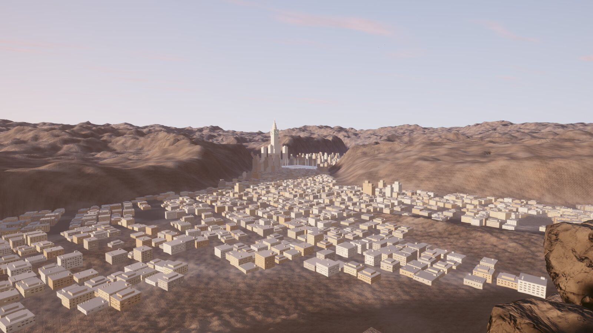
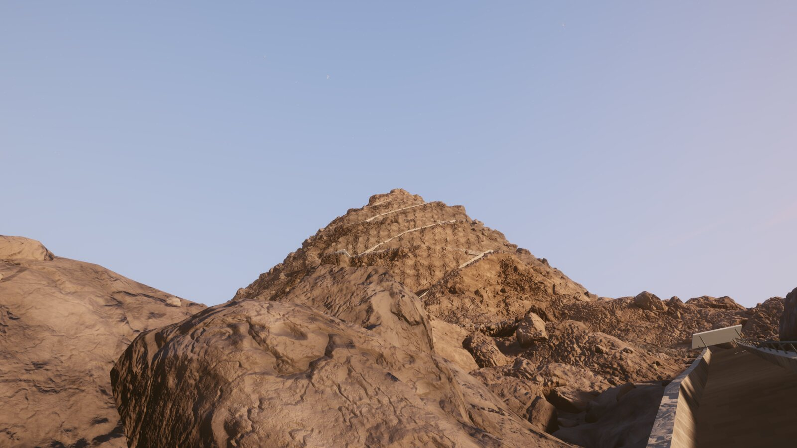
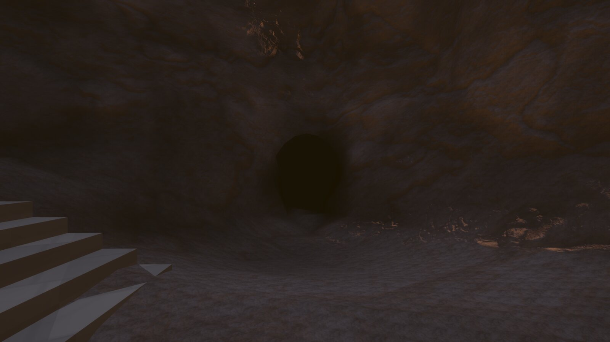
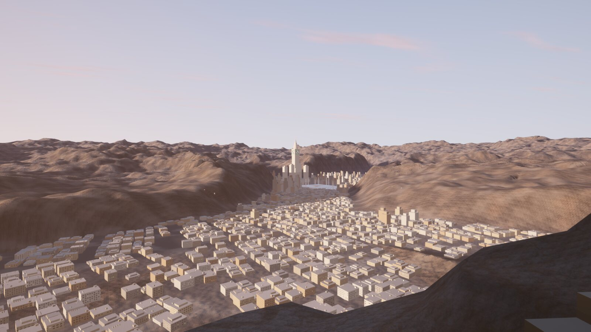
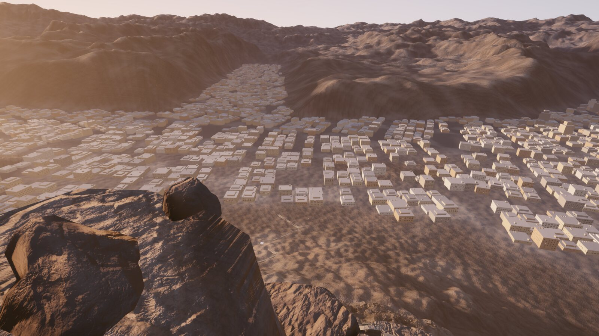
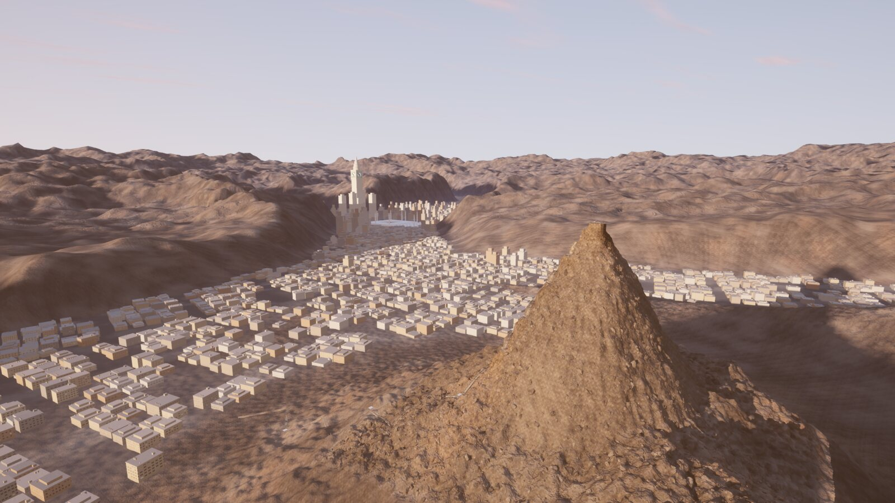
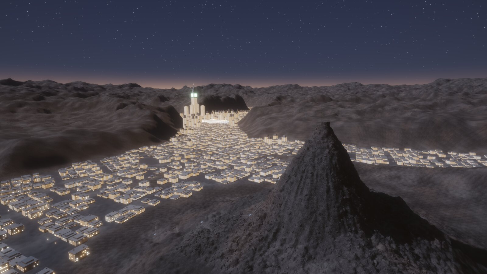

# Jabal al-Nour

<p align="center">
  <a href="https://moeymakes.github.io/makkah-jabal-al-nour/"></a>
</p>
<p align="center"><b><a href="https://moeymakes.github.io/makkah-jabal-al-nour/">moeymakes.github.io/makkah-jabal-al-nour/</a></b><br>
<sub>Chrome or Edge on a desktop or laptop (needs WebGPU) · nothing to install · one HTML file</sub></p>

**Climb the stepped path up Jabal al-Nour above Makkah to the Cave of Hira, right in your browser.**

A steep mountain of dark granite boulders with a stone path, low walls and railings zig-zagging up it, rest
platforms with shade roofs, the summit, and just below the top the narrow mouth of the Cave of Hira in a cleft of
leaning rocks, facing the Kaaba. Far below, Makkah fills the valleys between bare mountains, with the Grand Mosque
and the clock tower in the distance. Everything is made by code: no images, no 3D models, no sound files. The whole
world is **one HTML file** of about 97 KB.

The geography is composed and compressed so it fits in one view (the Haram is closer than in reality), and the
buildings are respectful approximations, not replicas. The cave is shown from outside only. There are no people in
the scene, no writing anywhere, and nothing is recited.

[](https://moeymakes.github.io/makkah-jabal-al-nour/)

| | |
|---|---|
|  |  |
|  |  |





## Try it

1. Open **[https://moeymakes.github.io/makkah-jabal-al-nour/](https://moeymakes.github.io/makkah-jabal-al-nour/)** in **Chrome** or **Edge** on a desktop computer, or download
   [`index.html`](index.html) and open it from your computer (it works offline).
2. Wait a few seconds while the mountain is built, then press **Enter** and start climbing.

It needs a browser with **WebGPU**.

## What's there

- **The mountain**: a steep cone of granite carrying a second, steeper knob, piled with boulders and core stones
- **The path**: about 1,700 steps in zig-zag flights, low stone walls, railings where it is steep, paved landings at
  every turn and rest platforms with shade roofs
- **The summit** with a ring of low wall, and **the Cave of Hira** just below it on the side facing the Kaaba
- **Makkah below**: houses and blocks filling the valleys, hotels and towers near the Haram, the Grand Mosque with
  its minarets, and the clock tower with its four lit dials
- **Time**: **Dawn**, **Golden hour** or **Night** in the menu (remembered; the page reloads). At night the city's
  windows and street lamps light up, the clock face glows white and green, and the stars come out
- **Sound** made up as you listen: wind over the rocks, the gusts whistling higher up, birds and rock doves at dawn,
  the distant hum of the city at night

## Controls

| | Keyboard & mouse |
|---|---|
| Look around | Move the mouse (or drag with the left button where the mouse cannot be captured) |
| Walk | `W` `A` `S` `D` |
| Run | Hold `Shift` |
| Fly / walk | `F`, or `E` to lift off from walking |
| Up / down | `E` / `Q` (descending onto the ground lands you back to walking) |
| Jump to a viewpoint | `1` to `6` |
| Menu | `Esc` |
| Sound on / off | `M` |
| Sound mix | **Mountain**, **Wind**, **Birds**, **Calm** or **Off** in the menu, plus a volume slider (remembered next visit) |
| Time of day | **Dawn**, **Golden hour** or **Night** in the menu (reloads the page) |
| Performance stats | `H` |
| Detail level | **Low**, **Medium** or **High** in the menu (reloads the page) |

**On a touchscreen:** hold one finger down to walk forward and slide it to look around; a second finger runs;
the ✈ button toggles flight.

## How it works

- The ground model (the mountain, the valleys, the ranges, the city and the Haram plaza) is one function evaluated
  on the graphics card when the page opens: at 1 m over the mountain, 2 m over the 2 km around it and about 23 m
  over 24 km of surroundings.
- The upper mountain is a 3D density field turned into a mesh, so boulders can overhang, the path can be cut into
  the rock as a level bench, and the cave mouth can sit in a cleft under leaning boulders.
- The far landscape is a ring-shaped mesh out to 12 km with soft shadows baked from the low sun; the long shadows of
  the far ranges reach the near mountain and the city through a baked "lit height".
- Everything is drawn with **WebGPU** directly. No engine or 3D library.
- The method, the verification loop and the page structure follow
  [Abyssal Garden](https://github.com/noniv/abyssal-garden) (MIT), via the `worldsmith` skill.

## Make it your own

Source is in [`source`](source). Rebuild with Node.js 18+:

```bash
cd source && npm install && npm run build
```

| File | What's inside |
|---|---|
| [`source/src/world.js`](source/src/world.js) | Layout: the path, the cave, the Haram, the clock tower, the city, rocks, viewpoints and the camera path |
| [`source/src/shaders.js`](source/src/shaders.js) | The ground model, sky and haze, granite and stonework, buildings, lamps, stars and the final image |
| [`source/src/main.js`](source/src/main.js) | Renderer, walking and flying, collision, controls |
| [`source/src/audio.js`](source/src/audio.js) | The soundscape |
| [`source/src/quality.js`](source/src/quality.js) | Detail levels and the three times of day |
| [`source/template.html`](source/template.html) | The page: loading bar, menu, controls list |

`npm run build:dev` writes `dev.html` with a scripted one-minute flight (`P`) and a benchmark (`B`).

## Other worlds in this series

- **[Madinah Horizon](https://moeymakes.github.io/madinah-horizon/)**: the date gardens, lava fields and hills around Madinah at golden hour ([source](https://github.com/moeymakes/madinah-horizon))
- **[Nabawi Courtyard](https://moeymakes.github.io/masjid-nabawi-courtyard/)**: the marble plaza of the Prophet's Mosque up close, as the great umbrellas open ([source](https://github.com/moeymakes/masjid-nabawi-courtyard))
- **[Madinah, First Years](https://moeymakes.github.io/madinah-first-years/)**: the oasis and the first mosque around 622-632 CE, an artistic reconstruction ([source](https://github.com/moeymakes/madinah-first-years))

## License

MIT. Parts adapted from Abyssal Garden (MIT); its notice is in `source/LICENSE-abyssal-garden`.
